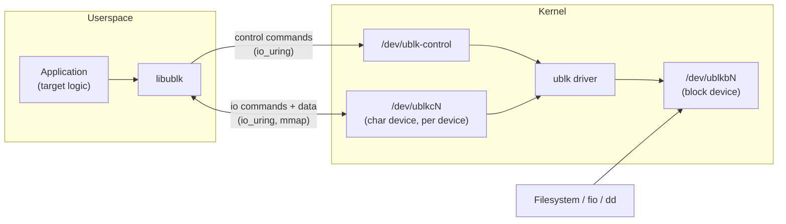
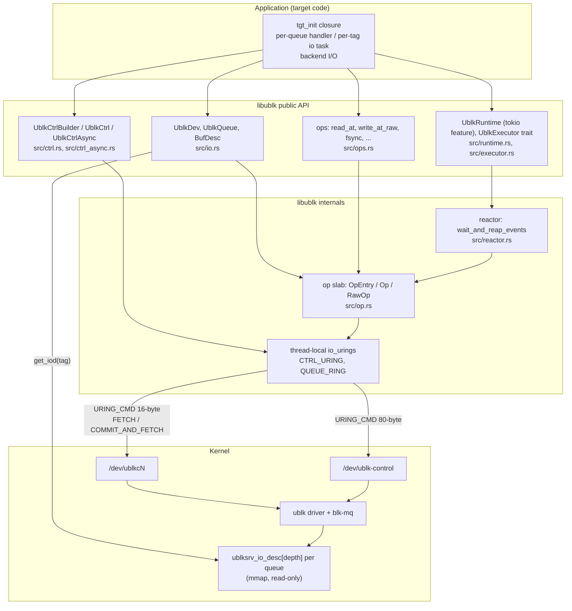
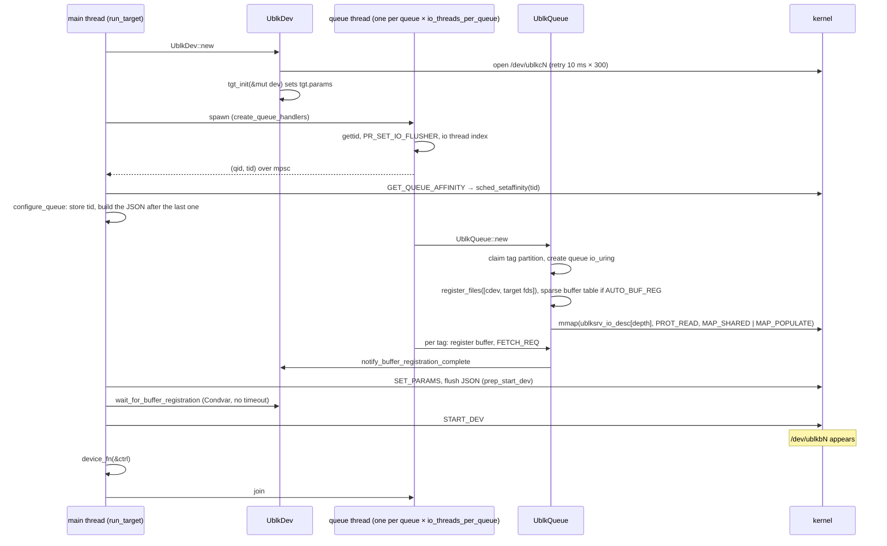
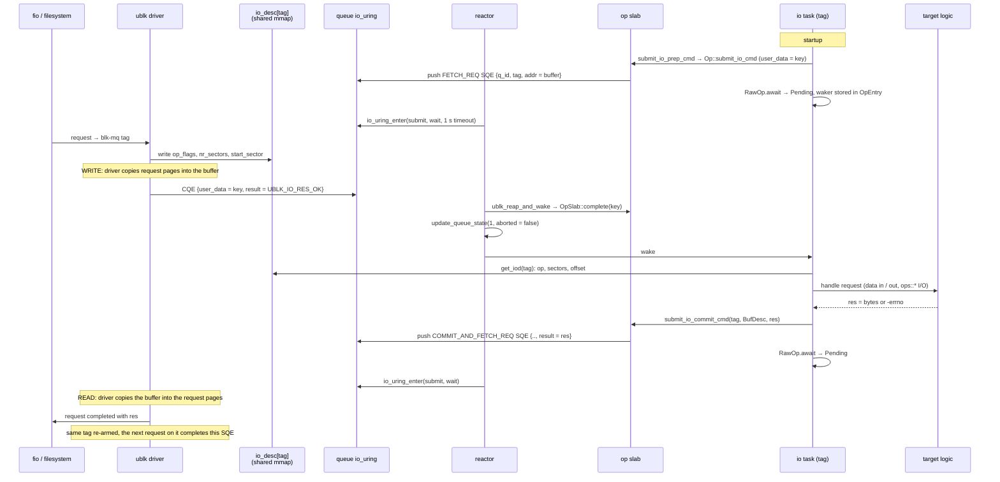

# libublk: framework and core design

This document explains how `libublk` is built and how a block request
flows through it. It is written for an engineer who knows Linux and
block storage but has not read this code before.

Paths are relative to the repository root and links resolve inside it.
Code is referred to by file and item name rather than line number, so
the text survives edits; `grep` for the name. Kernel behaviour is
described only where this code or the UAPI header
`libublk-rs-sys/ublk_cmd.h` shows it; the one exception, when the
driver copies data, is called out in section 6.

---

## 1. What is libublk?

`ublk` is a Linux kernel driver (`CONFIG_BLK_DEV_UBLK`, Linux 6.0+)
that exposes a normal block device, `/dev/ublkbN`, while all of the
device's logic runs in a userspace process. The kernel forwards each
block request to that process through `io_uring`, and the process
answers with a result.

`libublk` is a Rust library for writing that process. It handles what
is the same for every device, so the developer only writes the part
that is specific to their storage backend.

| The framework handles | The application implements |
|---|---|
| Opening `/dev/ublk-control` and creating, starting, stopping and deleting the device | Device size and parameters (one callback) |
| Opening `/dev/ublkcN` and mapping the shared request descriptors | What READ, WRITE, FLUSH, DISCARD... mean for its backend |
| One `io_uring` per thread, thread pinning, tag ownership | Optional: its own backend I/O through the typed `ops` catalog |
| The FETCH / COMMIT_AND_FETCH command protocol and request accounting | The number of queues, the queue depth, and the buffer mode |
| Buffer registration, zero-copy modes, the recovery state file | |
| Waking the right task when the kernel delivers a request | |



Two kernel files matter. `/dev/ublk-control` takes device-level
commands (ADD_DEV, SET_PARAMS, START_DEV, STOP_DEV, DEL_DEV).
`/dev/ublkcN` is the per-device char device: it carries the per-request
commands and, in copy mode, the data, and it exposes the request
descriptor array through `mmap`. Both are driven with
`IORING_OP_URING_CMD` submissions; libublk never uses `ioctl()` on them.

---

## 2. A minimal example

The smallest complete target is the null device in
[`examples/null.rs`](../examples/null.rs). Its async path
(`null add --async`), lightly trimmed:

```rust
// the whole "backend": report the request size
fn get_io_cmd_result(q: &UblkQueue, tag: u16) -> i32 {
    let iod = q.get_iod(tag);                 // request descriptor, shared with the kernel
    (iod.nr_sectors << 9) as i32              // bytes transferred
}

// one async task per tag
async fn __null_io_task(q: &UblkQueue, tag: u16, buf: Option<&IoBuf<u8>>, user_copy: bool)
    -> Result<(), UblkError>
{
    let buf_desc = match buf {
        Some(io_buf) => BufDesc::Slice(io_buf.as_slice()),   // copy mode
        None if user_copy => BufDesc::Slice(&[]),             // UBLK_F_USER_COPY
        _ => BufDesc::AutoReg(auto_buf_reg),                  // UBLK_F_AUTO_BUF_REG zero copy
    };
    q.submit_io_prep_cmd(tag, buf_desc.clone(), 0, buf).await?;     // FETCH_REQ: wait for the 1st request
    loop {
        let res = get_io_cmd_result(&q, tag);                        // handle it
        q.submit_io_commit_cmd(tag, buf_desc.clone(), res).await?;  // COMMIT_AND_FETCH_REQ: answer + wait for the next
    }
}

// per-queue thread body
fn q_async_fn(qid: u16, dev: &Arc<UblkDev>, user_copy: bool, zero_copy: bool) {
    libublk::UblkRuntime::run_io_tasks(dev, qid, move |q, tag| async move {
        null_io_task(&q, tag, user_copy, zero_copy).await
    }).unwrap();
}

// create and run the device
let ctrl = UblkCtrlBuilder::default()
    .name("example_null").id(id)
    .depth(depth).nr_queues(nr_queues).io_buf_bytes(buf_size)
    .ctrl_flags(ctrl_flags)                       // kernel UBLK_F_* flags
    .dev_flags(UblkFlags::UBLK_DEV_F_ADD_DEV | UblkFlags::UBLK_DEV_F_SINGLE_CPU_AFFINITY)
    .build().unwrap();                            // ADD_DEV is sent here
let tgt_init = |dev: &mut UblkDev| { dev.set_default_params(250_u64 << 30); Ok(()) };
let wh = move |d_ctrl: &UblkCtrl| { d_ctrl.dump(); if oneshot { d_ctrl.kill_dev().unwrap(); } };
ctrl.run_target(tgt_init, q_async_handler, wh).unwrap();
```

What happens, in order:

1. `build()` validates the configuration, opens `/dev/ublk-control`,
   creates a control `io_uring` on the calling thread, and sends
   `ADD_DEV`. The kernel assigns the device id and `/dev/ublkcN` appears.
2. `run_target` runs `tgt_init` once to fill in the device parameters,
   opens `/dev/ublkcN`, and spawns one thread per queue, pinned to the
   queue's CPU mask.
3. Each queue thread creates a `UblkQueue` (queue ring, fixed files,
   mapped descriptor array) and runs one async task per tag. Each task
   registers its buffer and arms a `FETCH_REQ`.
4. `run_target` sends `SET_PARAMS`, writes the JSON state file, waits
   until every queue thread has registered its buffers, then sends
   `START_DEV`. `/dev/ublkbN` appears.
5. `wh` runs on the main thread (here: print the device, or kill it in
   one-shot mode). The main thread then joins the queue threads.
6. For each request the kernel writes the tag's descriptor and
   completes the armed command; the task reads the descriptor, handles
   it, and sends `COMMIT_AND_FETCH_REQ`, which answers this request and
   re-arms the tag.
7. On `STOP_DEV` the kernel completes every armed command with
   `UBLK_IO_RES_ABORT`. The tasks see `UblkError::QueueIsDown` and
   return, the threads exit, and `run_target` returns. Dropping `ctrl`
   sends `DEL_DEV`.

The README's Quick Start is the same program with a Ctrl-C handler that
calls `kill_dev()`.

---

## 3. Overall architecture



**Application.** The target supplies a `tgt_init` closure that sets the
device parameters, a queue handler that runs on each queue thread, and
the backend logic. It never builds `io_uring` entries for the ublk
protocol itself.

**Public API.** Section 4 lists each type. The split is `UblkCtrl` for
the device, `UblkDev` and `UblkQueue` for the data side, `ops` for a
target's own I/O on the same ring, and `UblkRuntime` (or any
`UblkExecutor`) for running the tasks.

**Internals.** Every awaited `io_uring` submission gets an entry in a
thread-local slab (`src/op.rs`); the slab key is the SQE `user_data`.
The reactor (`src/reactor.rs`) is the only place that calls
`io_uring_enter` in the async model: it submits pending SQEs, waits for
completions, routes each to its slab entry, and wakes the owning task.
`UblkQueueState` counts armed commands and records when the queue is
stopping.

**Rings and kernel.** Both rings are thread-local and created lazily:
the control ring (`CTRL_URING`, 128-byte SQEs for 80-byte control
payloads) and the queue ring (`QUEUE_RING`, 64-byte SQEs). A thread may
have either or both. The driver writes each request's descriptor into
a per-queue array that userspace maps read-only, indexed by tag; how
the data itself moves depends on the buffer mode (section 6.4).

---

## 4. Core types

| Type | What it is |
|---|---|
| `UblkCtrlBuilder` (`src/ctrl.rs`) | Device configuration: name, id, `nr_queues`, `depth`, `io_buf_bytes`, kernel `ctrl_flags`, library `dev_flags`, `io_threads_per_queue`. Defaults: 1 queue, depth 64, 512 KiB buffers. `build()` sends ADD_DEV. |
| `UblkCtrl` / `UblkCtrlInner` (`src/ctrl.rs`) | The device lifecycle: the `/dev/ublk-control` fd, `ublksrv_ctrl_dev_info`, the JSON state file, the queue thread ids. `UblkCtrl` is a `RwLock<UblkCtrlInner>`; `Drop` sends DEL_DEV if this handle added the device. `UblkCtrlAsync` (`src/ctrl_async.rs`) wraps the same inner for `.await` use. |
| `UblkDev` (`src/io.rs`) | The data side: the open `/dev/ublkcN`, a copy of `dev_info`, the `UblkTgt` parameters, and the buffer-registration handshake. Shared as `Arc<UblkDev>` by every queue thread. |
| `UblkTgt` (`src/io.rs`) | Target-visible parameters: `dev_size`, `ublk_params`, extra fixed fds (`fds[0]` is the char device, target files start at 1). Edited by `tgt_init`; serialized to the recovery JSON. |
| `UblkQueue` (`src/io.rs`) | One queue, or one thread's share of it: the mapped descriptor array, the owned tag set, per-tag buffer pointers, the queue state. Builds and submits FETCH / COMMIT_AND_FETCH. `Rc`, not `Send`. |
| `UblkQueueState` (`src/io.rs`) | `cmd_inflight` plus the STOPPING / IDLE / MLOCK_FAIL flags. Both processing models record completions here: `deliver_cqes` (sync loop) and `update_queue_state` (reactor). `is_stopping()` and `queue_is_done()` drive shutdown. |
| `BufDesc` / `BufDescList` (`src/io.rs`) | Where a request's data lives: `Slice` (copy mode, or empty for user copy), `AutoReg` (kernel-registered buffer index), `ZonedAppendLba`, `RawAddress`. `validate_compatibility` rejects a variant the device flags do not support. |
| `ublksrv_io_desc` (`ublk_cmd.h`) | The request, written by the kernel: `op_flags` (op in bits 0-7, flags above), `nr_sectors`, `start_sector`, `addr`. Read in place through `UblkQueue::get_iod(tag)`. |
| `UblkIOCtx` (`src/io.rs`) | Sync model only: one completion plus its handler word, passed to the target's closure (section 6.3). |
| `Op` / `OpEntry` / `RawOp` (`src/op.rs`, `src/ops.rs`) | One awaited `io_uring` operation. `OpEntry` is the slab slot (waker, inline result slots, owned resources); `Op` the crate-private handle; `RawOp` the public future yielding the CQE result. Created by `UblkQueue::submit_io_cmd_async` and every `ops::*` function. |
| reactor (`src/reactor.rs`) | Submits SQEs, blocks in `io_uring_enter`, drains CQEs, wakes tasks. Executor-agnostic. |
| `UblkRuntime` / `UblkExecutor` (`src/runtime.rs`, `src/executor.rs`) | A Tokio current-thread runtime plus `LocalSet` whose park hook calls the reactor; the trait (`new`, `block_on`, `spawn`, `run_io_tasks`) a custom executor implements. |
| `IoBuf<T>` (`src/helpers.rs`) | A 4096-byte-aligned heap buffer with optional `mlock`: the per-tag copy-mode buffer. |
| `ShmemBuf` / `ShmemBufs` (`src/shmem.rs`) | Shared-memory zero copy (`UBLK_F_SHMEM_ZC`): registers `MAP_SHARED` mappings and resolves a flagged request's `(index, offset)`. Per request, not a buffer mode. |
| `UblkError` (`src/lib.rs`) | `UringIOError(errno)`, `IOError`, `JsonError`, `InvalidVal`, `QueueIsDown`, `OtherError(errno)`; `errno()` maps any variant to a negative errno. |

The `op` and `multishot` modules are private. Buffer, shared-memory,
executor and runtime types are re-exported from the crate root; the
control, device, queue and helper types live in `ctrl`, `io` and
`helpers`.

---

## 5. Initialization and device lifecycle

### 5.1 Configuration

Three flag sets are involved:

| Flags | Where they go | Examples |
|---|---|---|
| `ctrl_flags` (kernel `UBLK_F_*`) | `ublksrv_ctrl_dev_info.flags`, sent with ADD_DEV | `UBLK_F_USER_COPY`, `UBLK_F_AUTO_BUF_REG`, `UBLK_F_USER_RECOVERY`, `UBLK_F_PER_IO_DAEMON` |
| `dev_flags` (library `UblkFlags`) | `UblkCtrlInner`, copied into `UblkDev` and `UblkQueue` | `UBLK_DEV_F_ADD_DEV` (create, delete on drop), `UBLK_DEV_F_RECOVER_DEV`, `UBLK_DEV_F_SINGLE_CPU_AFFINITY`, `UBLK_DEV_F_MLOCK_IO_BUFFER` |
| Device parameters (`ublk_params`) | `UblkDev.tgt.params`, sent with SET_PARAMS before START_DEV | Set by `tgt_init`, typically `set_default_params(size)` |

`validate_new_params` rejects unknown kernel flags, internal
`dev_flags` bits, a missing `/dev/ublk-control` (with a "modprobe
ublk_drv" hint), mlock combined with user copy or zero copy, and
out-of-range queue, depth or buffer sizes. `UBLK_F_NEED_GET_DATA` is
deliberately unsupported.

### 5.2 Creating the device

`build()` validates, opens `/dev/ublk-control`, creates the
thread-local control ring (`init_ctrl_task_ring_default`), sends
`GET_FEATURES` (errors ignored) and then `ADD_DEV`. ADD_DEV is a
read-back command: the driver writes the assigned `dev_id` into the
`dev_info` struct in place, and the JSON manager records it.

A control command travels like this (`ublk_submit_cmd_sync`):

1. `UblkCtrlCmdData` names the opcode, an optional 64-bit data word and
   an optional buffer with direction; `ublk_ctrl_cmd_payload` fills the
   80-byte `ublksrv_ctrl_cmd`.
2. `Op::submit_ctrl` pushes a `UringCmd80` SQE on the control ring with
   the op-slab key as `user_data`.
3. The caller loops `submit_and_wait(1)` and reaps until the op has its
   result; async ops completed in the same batch are woken too.
4. An ioctl-encoded opcode rejected by an old kernel is retried once as
   the legacy one-byte opcode. A negative result becomes
   `UblkError::UringIOError`; `-EBUSY` counts as success.

`UblkCtrlAsync` sends the same payloads through `ops::uring_cmd80` and
`.await`s them. It has no `run_target`: the caller spawns the queue
threads and calls `configure_queue_async` and `start_dev_async` itself,
as [`examples/ramdisk.rs`](../examples/ramdisk.rs) does; pinning is
available separately through `set_thread_affinity_async`.

### 5.3 Queues, threads, and start

`run_target` is short enough to show:

```rust
let dev = &Arc::new(UblkDev::new(self.get_name(), tgt_fn, self)?);
let handles = self.create_queue_handlers(dev, q_fn);
self.start_dev(dev)?;
device_fn(self);
for qh in handles { qh.join()... }
let _ = self.stop_dev();   // -ENOENT is normal if deleted elsewhere
```



- **Threads.** `nr_hw_queues × io_threads_per_queue`. With more than
  one thread per queue (`UBLK_F_PER_IO_DAEMON`) each thread serves an
  interleaved tag set `idx, idx+n, idx+2n, ...` (`tag_partition`);
  `UBLK_DEV_F_SEQ_TAG_PARTITION` switches to contiguous blocks. `tags()`
  and `owns_tag()` hide which layout is in use. Each instance maps the
  descriptor array itself, and `claim_partition` stops two live
  instances from serving the same tag.
- **Affinity.** Each thread is pinned from the main thread to its
  queue's CPU mask, because blk-mq maps a request to the hardware queue
  of the submitting CPU. With `UBLK_DEV_F_SINGLE_CPU_AFFINITY` one
  random CPU from the mask is used, otherwise the whole mask.
- **The start handshake counts buffers, not FETCH commands.**
  `start_dev` waits until every queue thread has registered its last
  per-tag buffer. Devices with `UBLK_F_AUTO_BUF_REG` or
  `UBLK_F_USER_COPY` skip the wait. The async tasks also wait for each
  other: `submit_io_prep_cmd` registers its buffer and then takes a
  permit from a semaphore filled only when all of the thread's buffers
  are registered, so no FETCH is armed before every tag has a buffer.
- **The JSON state file** `/run/ublksrvd/<id>.json` holds `dev_info`,
  `UblkTgt`, and per-queue tid and affinity. Written by
  `prep_start_dev` and read back by recovery; 5.4 says who removes it.

### 5.4 Shutdown and cleanup

| Call | Sends | Notes |
|---|---|---|
| `kill_dev()` | `STOP_DEV` | Safe from any context, including inside `device_fn`. Leaves the JSON. |
| `stop_dev()` | `STOP_DEV` | Also removes the JSON if this handle added the device. Called by `run_target` after the threads join. |
| `del_dev()` | `DEL_DEV` | Removes the JSON. Can deadlock while the device is live and served by the caller. |

`Drop for UblkCtrlInner` sends `DEL_DEV` only if the handle was created
with `UBLK_DEV_F_ADD_DEV` and `disown()` was not called, then closes
`/dev/ublk-control`.

The queue threads find out from the kernel, not from the library:
`STOP_DEV` or `DEL_DEV` completes every armed command with
`UBLK_IO_RES_ABORT` (`-ENODEV`). `account_io_cmds(.., aborted = true)` sets
`UBLK_QUEUE_STOPPING`. In the async model the awaiting
`submit_io_prep_cmd` / `submit_io_commit_cmd` returns
`Err(UblkError::QueueIsDown)`, the task returns, `run_io_tasks` treats
that as a clean exit, and `block_on` returns when the last task ends.
In the sync model `__queue_io_cmd` stops re-arming and
`wait_and_handle_io` returns `QueueIsDown` once `cmd_inflight` is zero
and the submission queue is empty. `Drop for UblkQueue` deregisters the
thread-local state, unregisters files and buffers, and unmaps the
descriptor array (otherwise the char device is not released).
`/dev/ublkcN` closes when the last `Arc<UblkDev>` drops.

---

## 6. The block I/O path

This section follows one request on a copy-mode device in the async
model, which is what the examples and README use. The sync model and
the other buffer modes follow.



### 6.1 Step by step

**The kernel makes a request available.** `blk-mq` assigns a tag in
`[0, depth)`. The driver fills `ublksrv_io_desc[tag]` in the queue's
descriptor array, the region libublk mapped at
`UBLKSRV_CMD_BUF_OFFSET + q_id * cmd_buf_sz(UBLK_MAX_QUEUE_DEPTH)`,
then completes the `URING_CMD` armed for that tag with
`UBLK_IO_RES_OK`.

**Userspace receives it.** The queue thread is parked in
`io_uring_enter` inside `reactor::wait_for_cqe`, called from Tokio's
`on_thread_park` hook. `reap_queue_ring` drains the completion queue
through `ublk_reap_and_wake`: `classify_user_data` says who owns each
CQE; an io command is an ordinary slab entry flagged `is_io_cmd`, and
`OpSlab::complete` stores the result and hands back the task's waker. After the ring and slab borrows are
released, `update_queue_state` decrements `cmd_inflight` and the
collected wakers are woken.

`wait_for_cqe` is the only place the thread blocks. The same
`io_uring_enter` submits pending SQEs, and it waits with a one-second
safety timeout: a cross-thread wake (a `JoinHandle`, say) cannot
interrupt `io_uring_enter`, so on timeout the park hook wakes the
`block_on` root, Tokio runs its scheduler once, and parks again. If the
thread also has a control ring, its fd is polled from the queue ring
(`PollAdd` with the sentinel `CTRL_POLL_DATA`) so one wait covers both;
this is how the ramdisk example runs control and I/O on one thread.
`ParkOutcome::NoPendingOps` tells the executor nothing is in flight, so
it may sleep on its own primitive; a custom executor implements
`UblkExecutor` and follows the contract in `src/executor.rs`.

**There is no per-request object.** The task identifies the request by
its tag and reads the descriptor in place with `get_iod(tag)`:

```rust
let iod = q.get_iod(tag);
let op    = iod.op_flags & 0xff;            // UBLK_IO_OP_READ = 0, WRITE = 1, FLUSH = 2, ...
let off   = (iod.start_sector << 9) as usize;
let bytes = (iod.nr_sectors << 9) as usize;
let flags = iod.op_flags >> 8;              // UBLK_IO_F_FUA, UBLK_IO_F_SHMEM_ZC, ...
```

**Dispatch is the task resuming.** Polling a `RawOp` is a slab lookup,
no syscall: with no result stored, the task's waker is saved in the
`OpEntry` and the task yields; with one, the `RawOp` resolves and the
task's own code continues after the `.await`. There is no callback
registry and no dispatch table: the task *is* the handler for its tag,
one per tag owned by the thread, spawned by `run_io_tasks` on a Tokio
`LocalSet`. Tokio's I/O and time drivers are not enabled; `io_uring` is
the only event source.

**Data.** In copy mode the `BufDesc::Slice` buffer passed to FETCH /
COMMIT is the data area: for WRITE it already holds the data when the
task wakes, for READ the task fills it before committing (see the
ramdisk example). The library documents only that "data is copied
between this buffer and kernel buffers"; that the driver copies WRITE
data in before completing the FETCH and READ data out at COMMIT is
kernel behaviour the examples rely on. A backend that needs its own
I/O awaits an `ops::*` future on the same ring, for example
`ops::read_at_raw(TgtFd::Fixed(1), buf, bytes, off)` in the loop
example; it goes through the same slab and reactor.

**Completion.** `submit_io_commit_cmd(tag, buf_desc, res)` copies `res`
(bytes transferred or a negative errno) verbatim into
`ublksrv_io_cmd.result`; the library never translates it, and
`UblkError::errno()` turns any error into this form. The SQE is only
pushed into the submission ring (`submit()` runs early only if the ring
is full); it reaches the kernel with the next `io_uring_enter`, the
same one that waits for new completions. The
driver reads `result`, ends the block request, and keeps the command
armed: one `COMMIT_AND_FETCH_REQ` answers the old request and asks for
the next.

### 6.2 The io command on the wire

Every FETCH / COMMIT_AND_FETCH is one `IORING_OP_URING_CMD` on fixed
file 0 (the char device) with a 16-byte payload, built by
`build_io_cmd_sqe`:

```
struct ublksrv_io_cmd { u16 q_id; u16 tag; s32 result; u64 addr; }
```

`addr` is the copy-mode buffer, 0 for user copy and auto-buf-reg, the
zone-append LBA for zoned devices, or a raw address. For
`BufDesc::AutoReg` the `ublk_auto_buf_reg` descriptor goes in
`sqe->addr` instead. The opcode is `UBLK_U_IO_*` (ioctl-encoded),
truncated to its low byte on kernels without
`UBLK_F_CMD_IOCTL_ENCODE`.

### 6.3 Sync model differences

The sync model (`null.rs` and `loop.rs` without `--async`) uses no
executor. A **sync-mode SQE** is either an io command from
`__queue_io_cmd` or a target I/O entry the closure submits with
`ublk_submit_sqe_sync(sqe, word)`. No future owns it: its slab entry
holds the handler word (tag, op, target data) in place of a waker, the
ring sees only the slab key, and the CQE comes back to the same closure
as a `UblkIOCtx` carrying that word.

| Step | Async model | Sync model |
|---|---|---|
| Arm tags | `submit_io_prep_cmd` per task | `submit_fetch_commands_unified(BufDescList)` once |
| Wait | Tokio park hook → `reactor::wait_for_cqe` | `wait_and_handle_io` → `__wait_ios` → `submit_with_args(1, 20 s timeout)` |
| Identify the CQE | slab key → `OpEntry` → waker | slab key → `OpEntry` → handler word (`take_sync_entry`) |
| Dispatch | task resumes after `.await` | `handle_cqe` calls the closure `FnMut(&UblkQueue, u16, &UblkIOCtx)`: for io commands only when `result == UBLK_IO_RES_OK`, for target I/O always |
| Complete | `submit_io_commit_cmd(...).await` | `complete_io_cmd_unified(tag, BufDesc, res)` pushes the SQE; the next `__wait_ios` submits it |
| Backend I/O | `ops::*` futures | `ublk_submit_sqe_sync(sqe, build_user_data(tag, op, data, true))`; its CQE returns to the closure with `is_tgt_io()` set |

The sync model marks an idle queue (timeout with an empty submission
ring) IDLE; the async model never sets IDLE.

### 6.4 Buffer modes

The command protocol is the same for every operation; only the data
direction and the buffer mode differ:

| Mode (device flag) | FETCH / COMMIT carry | WRITE: where the data is | READ: what the target does |
|---|---|---|---|
| Copy (default) | `addr` = `IoBuf` pointer | In the `IoBuf` when the task wakes | Fill the `IoBuf`, then commit |
| `UBLK_F_USER_COPY` | `addr` = 0, `BufDesc::Slice(&[])` | `pread(cdev, UblkIOCtx::ublk_user_copy_pos(q_id, tag, off))` | `pwrite` to the same offset, then commit. No example exercises this data path. |
| `UBLK_F_AUTO_BUF_REG` | `sqe->addr` = `ublk_auto_buf_reg {index, flags}` | The kernel registers the request pages at fixed-buffer `index` for the request's lifetime; `ops::write_at_fixed(.., index, ..)` | `ops::read_at_fixed` into the registered pages, then commit. With `UBLK_AUTO_BUF_REG_FALLBACK` check `UBLK_IO_F_NEED_REG_BUF` and call `submit_register_io_buf`. |
| `UBLK_F_SHMEM_ZC` (per request) | unchanged | `iod.addr` = `(index << 32) \| offset`; `ShmemBufs::resolve(iod)` gives a pointer into the target's own mapping; the kernel copies nothing | Write the data at the same pointer. Check `UBLK_IO_F_SHMEM_ZC` before any other buffer logic. |

FLUSH, DISCARD, WRITE_ZEROES and the zone operations carry no data. The
loop example maps FLUSH to `ops::sync_file_range`.

`UBLK_F_BATCH_IO` ([`src/io_batch.rs`](../src/io_batch.rs)) is a
separate copy-mode transport: tags are prepared in bulk
(`PREP_IO_CMDS`), delivered through multishot `FETCH_IO_CMDS` into
provided buffers, and completed in groups (`COMMIT_IO_CMDS`), driven
with `flush_and_wake_io_tasks` and `UblkBatchQueue::handle_cqe`. It is
not covered further here.

---

## 7. Concurrency and memory

### 7.1 What crosses threads

Each queue thread owns everything it touches on the hot path: the
queue ring and op slab (thread-local), the `UblkQueue` (`Rc`) and the
queue state (`Rc<RefCell<..>>`). Nothing on the request path takes a
lock. Cross-thread synchronization exists only off the hot path:

| Shared state | Mechanism | Used for |
|---|---|---|
| `UblkCtrlInner` | `RwLock` | Every control command and `configure_queue` |
| `UblkDev.buf_reg_sync` | `Mutex` + `Condvar` | Start handshake: queue threads notify, the main thread waits |
| `UblkDev.partition_claims` | `Mutex<Vec<bool>>` | Tag partition ownership |
| queue thread → main | `mpsc` channel | Reporting `(qid, tid)` for affinity |

### 7.2 Request identity

The tag identifies a request at every level. Kernel to userspace, it
indexes the shared descriptor array and names the armed `URING_CMD`.
Ring to task, the SQE `user_data` is owned by the op layer; its
keyspace (`classify_user_data` in `src/op.rs`, used by both the sync
loop and the reactor):

| `user_data` value | Owner | Meaning |
|---|---|---|
| `>= u64::MAX - 15` | sentinel | No op state (`CTRL_POLL_DATA`, ASYNC_CANCEL) |
| bit 63 (`UblkUringData::Target`) | target | Target-owned word: no lookup, no accounting, delivered untouched. **Sync loop only**: the reactor drops such a CQE and does not count the SQE as pending. Set by `build_user_data(.., true)` and by the batch transport's raw SQEs. |
| anything else | op slab | The key of an `OpEntry`: an async op whose entry holds a waker, or a sync-mode SQE whose entry holds the handler word (`tag \| op << 16 \| tgt_data << 24`) |

Task to request, an async task was spawned for one tag and awaits one
command at a time, so it knows its tag without decoding anything; a
sync closure reads `UblkIOCtx::get_tag()`.

Each tag has at most one io command in flight and io commands post
exactly one CQE. A CQE for an op whose future was dropped
("orphaned") is still counted but never marks the queue stopping, so a
stale ABORT from an earlier queue on the same thread cannot stop a new
one.

### 7.3 Memory

| Memory | Owner | Lifetime | Notes |
|---|---|---|---|
| Descriptor array (`io_cmd_buf`) | kernel; mapped read-only per `UblkQueue` | `UblkQueue::new` → `Drop` | `depth × 24` bytes rounded to a page |
| Per-tag `IoBuf` | the io task (async) or the queue closure (sync) | must outlive the armed FETCH | `submit_io_prep_cmd` refuses a slice that is not the `IoBuf`. The kernel holds the address until the command is aborted; cancelling a FETCH does not release it. |
| Fixed buffer table | queue ring (`register_buffers_sparse(depth)`) | `UblkQueue` lifetime | Auto-buf-reg only; slot = tag by convention |
| `OpEntry` | op slab (thread-local) | submit → terminal CQE | 64 bytes, one cache line. In-flight entries are leaked at thread exit on purpose: the kernel may still write into their buffers. |
| Shared-memory ZC mappings | `ShmemBufs` | until `unregister_shmem_buf` | Registered with the driver by index |

---

## 8. Error handling and cleanup

All public functions return `Result<_, UblkError>`.

| Failure | Surfaces as | Cleanup |
|---|---|---|
| Bad configuration, missing `/dev/ublk-control`, mlock with zero copy (`validate_new_params`) | `InvalidVal`, `OtherError(-ENOENT)` | Nothing created |
| `ADD_DEV` rejected | `UringIOError` from `build()` | The half-built inner drops; its `Drop` attempts `DEL_DEV` and ignores the error |
| `io_threads_per_queue` invalid or `UBLK_F_PER_IO_DAEMON` missing (`set_io_threads_per_queue`) | `OtherError(-EINVAL / -ENOTSUP)` from `build()` | The device was already added, so `Drop` deletes it |
| `/dev/ublkcN` never appears, or `tgt_init` fails | returned from `run_target` before any thread starts | Dropping `UblkCtrl` deletes the device |
| `UblkQueue::new` fails, or an io task returns an error other than `QueueIsDown` | `wait_for_buffer_registration` returns `OtherError(-EIO)` | `notify_queue_setup_failed` + `fail_buffer_registration`: sibling tasks are released and exit with `QueueIsDown` |
| mlock fails | `OtherError(-EPERM)` from `start_dev` | Queue marked `MLOCK_FAIL`, the loop exits |
| `SET_PARAMS` / `START_DEV` rejected | `UringIOError` from `run_target` | Queue threads are **not** joined on this path; dropping `UblkCtrl` sends `DEL_DEV`, which aborts their commands so they exit |
| A queue handler that never registers buffers and never reports failure | `wait_for_buffer_registration` hangs (no timeout) | Documented hazard; `run_io_tasks` always reports |
| Backend I/O fails | the target commits a negative errno; the kernel fails the block request | None needed |
| SQ full after one flush (`push_sqe`) | `OtherError(-EBUSY)`; an io command marks the queue stopping | Sync: logged as a lost command |

Design points:

- **`QueueIsDown` is the normal end**, not a failure. Handlers propagate
  it with `?` and the framework treats it as success.
- **Errors on the io path stay on the io path.** A failed backend
  operation becomes a negative result in `COMMIT_AND_FETCH`; the
  framework never inspects it.
- **Cleanup follows creation.** `UblkCtrl` deletes the device it added,
  `UblkQueue` unmaps what it mapped and unregisters what it registered,
  `UblkDev` closes the char device. Thread-local rings are never
  explicitly closed.
- **Panics in a task are logged and treated as completion**
  (`TokioTask` in `src/runtime.rs`). Poisoned `RwLock`s on the control
  object are recovered with a warning.

---

## 9. Where to read next

| File | Why |
|---|---|
| [`examples/null.rs`](../examples/null.rs) | Smallest complete target, both models, every buffer mode |
| [`src/ctrl.rs`](../src/ctrl.rs) | `UblkCtrlBuilder`, `UblkCtrl`, `run_target`, control command encoding, JSON state, recovery |
| [`src/io.rs`](../src/io.rs) | `UblkDev`, `UblkQueue`, `BufDesc`, io command SQE building, the sync event loop, the async prep/commit methods |
| [`src/op.rs`](../src/op.rs) | The op slab, the `user_data` keyspace, `ublk_reap_and_wake`, cancellation |
| [`src/reactor.rs`](../src/reactor.rs) | The one blocking `io_uring_enter`, the executor idle-hook contract |
| [`src/runtime.rs`](../src/runtime.rs), [`src/executor.rs`](../src/executor.rs) | Tokio glue and the `UblkExecutor` trait, including `run_io_tasks` |
| [`src/ops.rs`](../src/ops.rs) | Typed `io_uring` operations a backend can `.await` |
| [`examples/loop.rs`](../examples/loop.rs) | Real backend I/O through `ops`, auto-buf-reg zero copy, several io threads per queue |
| [`examples/ramdisk.rs`](../examples/ramdisk.rs) | Control and I/O on one thread with `UblkCtrlAsync`; recovery |
| `libublk-rs-sys/ublk_cmd.h` | The kernel UAPI: opcodes, `ublksrv_io_desc`, `ublksrv_io_cmd`, flags, result codes |
