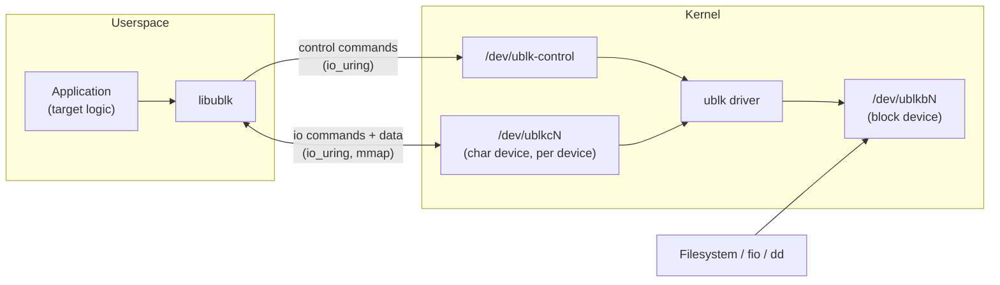
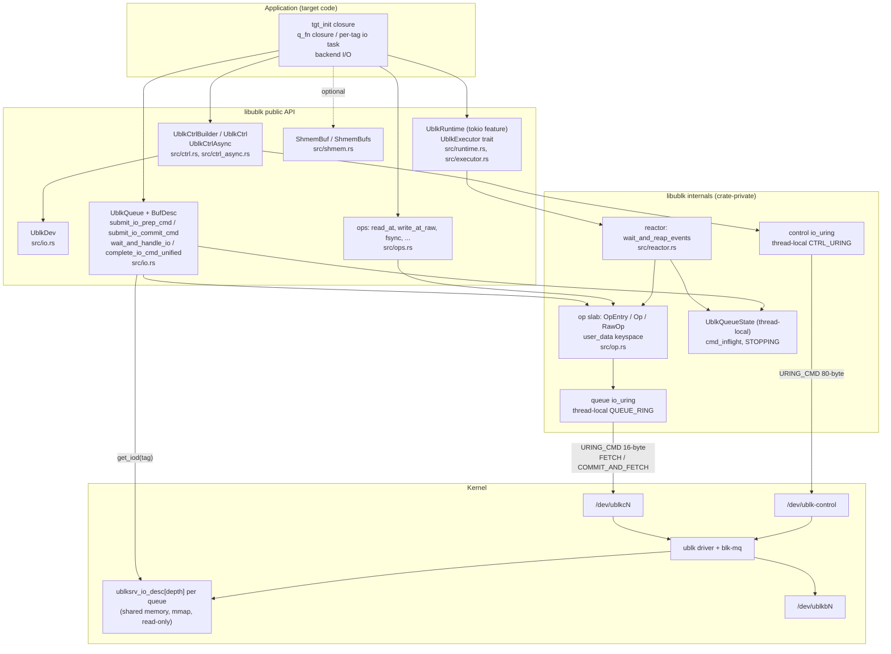
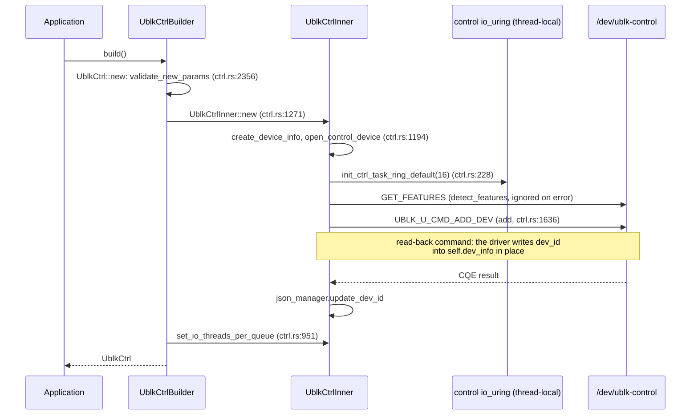
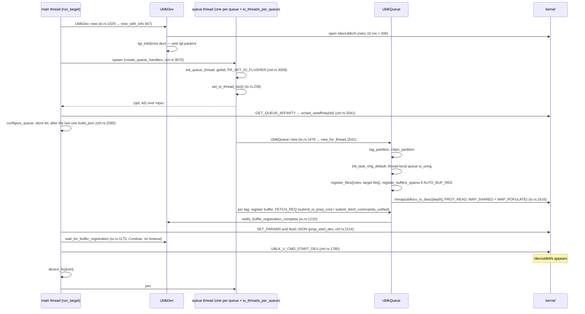
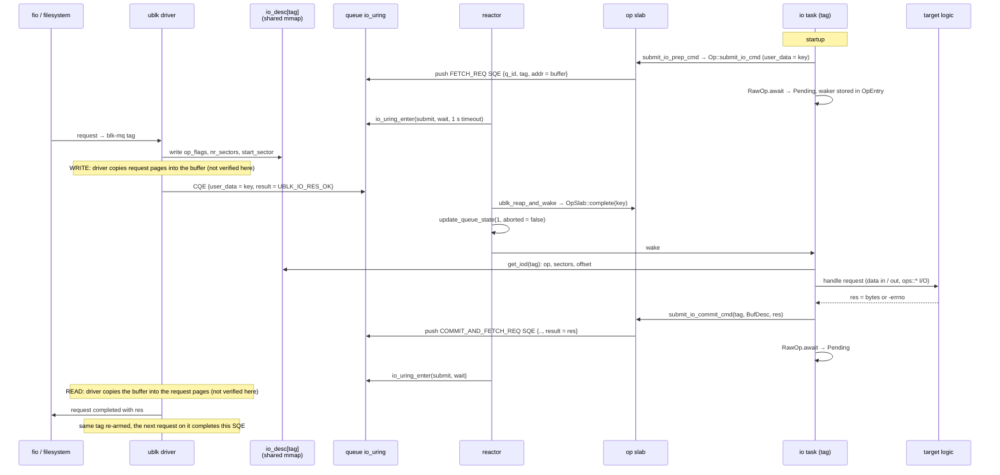
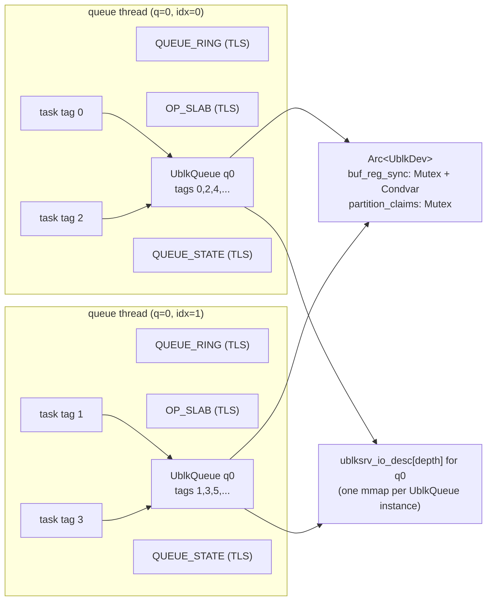
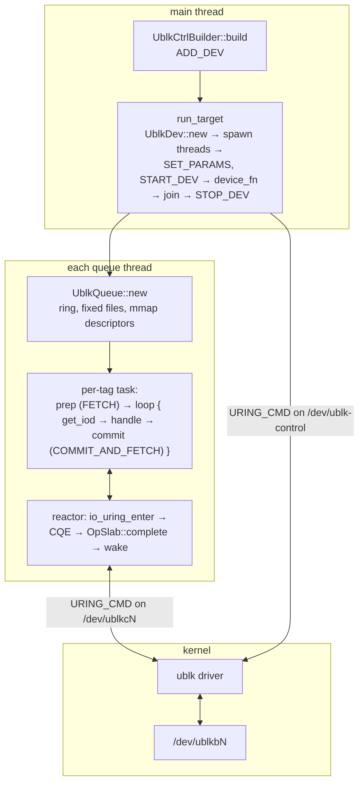

# libublk: framework and core design

This document explains how `libublk` is built and how a block request
flows through it. It is written for an engineer who knows Linux and
block storage but has not read this code before.

All file paths are relative to the repository root. Line numbers refer
to local commit `a8b552b` (branch `perf-opentry-64`, October 2026) and
will drift as the code changes. Links such as
[`src/io.rs`](../src/io.rs) resolve inside the repository.

Kernel behaviour is described only where the library's own code or the
UAPI header `libublk-rs-sys/ublk_cmd.h` shows it. Statements that could
not be verified from this repository are marked **(not verified here)**.

---

## 1. What is libublk?

`ublk` is a Linux kernel driver (`CONFIG_BLK_DEV_UBLK`, Linux 6.0+)
that exposes a normal block device, `/dev/ublkbN`, while all of the
device's logic runs in a userspace process. The kernel forwards each
block request to that process through `io_uring`, and the process
answers with a result.

`libublk` is a Rust library for writing that userspace process. It
handles the parts that are the same for every device, so the developer
only writes the part that is specific to their storage backend.

| The framework handles | The application implements |
|---|---|
| Opening `/dev/ublk-control` and creating/starting/stopping/deleting the device | Device size and parameters (one callback) |
| Opening `/dev/ublkcN` and mapping the shared request descriptors | What a READ, WRITE, FLUSH, DISCARD... means for its backend |
| One `io_uring` per thread, thread pinning, tag ownership | Optional: its own backend I/O through the typed `ops` catalog |
| The FETCH / COMMIT_AND_FETCH command protocol and request accounting | The number of queues, the queue depth, and the buffer mode |
| Buffer registration, zero-copy modes, recovery state file | |
| Waking the right task when the kernel delivers a request | |



Two kernel files matter:

- `/dev/ublk-control` receives device-level commands such as ADD_DEV,
  SET_PARAMS, START_DEV, STOP_DEV, DEL_DEV.
- `/dev/ublkcN` is the per-device "char device". It carries the per-request
  commands and, in copy mode, the data. It also exposes the request
  descriptor array through `mmap`.

Both are driven with `IORING_OP_URING_CMD` submission entries. libublk
never uses `ioctl()` for them.

---

## 2. A minimal example

The smallest complete example is the null device in
[`examples/null.rs`](../examples/null.rs). It discards writes and
returns whatever is in the buffer for reads. Below is its async path
(`null add --async`), lightly trimmed. Every call shown exists in the
repository.

```rust
// examples/null.rs:20-25 — the whole "backend": report the request size
fn get_io_cmd_result(q: &UblkQueue, tag: u16) -> i32 {
    let iod = q.get_iod(tag);                 // request descriptor, shared with the kernel
    (iod.nr_sectors << 9) as i32              // bytes transferred
}

// examples/null.rs:109-137 — one async task per tag
async fn __null_io_task(q: &UblkQueue, tag: u16, buf: Option<&IoBuf<u8>>, user_copy: bool)
    -> Result<(), UblkError>
{
    let buf_desc = match buf {
        Some(io_buf) => BufDesc::Slice(io_buf.as_slice()),   // copy mode
        None if user_copy => BufDesc::Slice(&[]),             // UBLK_F_USER_COPY
        _ => BufDesc::AutoReg(auto_buf_reg),                  // UBLK_F_AUTO_BUF_REG zero copy
    };
    q.submit_io_prep_cmd(tag, buf_desc.clone(), 0, buf).await?;     // FETCH_REQ: wait for 1st request
    loop {
        let res = get_io_cmd_result(&q, tag);                        // handle it
        q.submit_io_commit_cmd(tag, buf_desc.clone(), res).await?;  // COMMIT_AND_FETCH_REQ: answer + wait for next
    }
}

// examples/null.rs:158-163 — per-queue thread body
fn q_async_fn(qid: u16, dev: &Arc<UblkDev>, user_copy: bool, zero_copy: bool) {
    libublk::UblkRuntime::run_io_tasks(dev, qid, move |q, tag| async move {
        null_io_task(&q, tag, user_copy, zero_copy).await
    }).unwrap();
}

// examples/null.rs:182-216 — create and run the device
let ctrl = UblkCtrlBuilder::default()
    .name("example_null").id(id)
    .depth(depth).nr_queues(nr_queues).io_buf_bytes(buf_size)
    .ctrl_flags(ctrl_flags)                       // kernel UBLK_F_* flags
    .dev_flags(UblkFlags::UBLK_DEV_F_ADD_DEV | UblkFlags::UBLK_DEV_F_SINGLE_CPU_AFFINITY)
    .build().unwrap();                            // -> ADD_DEV is sent here
let tgt_init = |dev: &mut UblkDev| { dev.set_default_params(250_u64 << 30); Ok(()) };
let wh = move |d_ctrl: &UblkCtrl| { d_ctrl.dump(); if oneshot { d_ctrl.kill_dev().unwrap(); } };
ctrl.run_target(tgt_init, q_async_handler, wh).unwrap();
```

Execution sequence:

1. `build()` opens `/dev/ublk-control`, creates a control `io_uring`
   on the calling thread, and sends `ADD_DEV`. The kernel allocates the
   device id and `/dev/ublkcN` appears.
2. `run_target` runs `tgt_init` once to fill in the device parameters,
   opens `/dev/ublkcN`, and spawns one thread per queue.
3. Each queue thread creates a `UblkQueue`, maps the descriptor array,
   and runs one async task per tag. Each task arms a `FETCH_REQ`.
4. `run_target` sends `SET_PARAMS` and writes the JSON state file,
   waits until every queue has registered its buffers, then sends
   `START_DEV`. `/dev/ublkbN` appears.
5. `wh` runs on the main thread (here: print the device, or kill it
   in one-shot mode). The main thread then joins the queue threads.
6. On `STOP_DEV`, the kernel completes every armed command with
   `UBLK_IO_RES_ABORT`. The tasks see `UblkError::QueueIsDown`, return,
   the threads exit, and `run_target` returns.
7. Dropping `ctrl` sends `DEL_DEV`.

The README's Quick Start is the same program with a Ctrl-C handler
that calls `kill_dev()`. It is not compiled by any test.

---

## 3. Overall architecture



Reading the diagram from top to bottom:

**Application.** The target supplies three things: a `tgt_init`
closure that sets the device parameters, a queue handler that runs on
each queue thread, and the backend logic. It never touches `io_uring`
entries for the ublk protocol itself.

**Public API.** `UblkCtrl` owns the device from the kernel's point of
view. `UblkDev` is the opened `/dev/ublkcN` plus target parameters.
`UblkQueue` is one queue on one thread and speaks the request
protocol. `ops` is a catalog of `io_uring` operations (file read,
write, fsync, timers, sockets) that the target can `.await` on the
same ring. `UblkRuntime` is a Tokio current-thread runtime wired to
the reactor. `UblkExecutor` is the trait that lets another executor
take that role.

**Internals.** Every `io_uring` submission that is awaited gets an
entry in a thread-local slab (`src/op.rs`). The slab key is the SQE
`user_data`. The reactor (`src/reactor.rs`) is the only place that
calls `io_uring_enter` in the async model: it submits pending SQEs,
waits for completions, routes each completion to its slab entry, and
wakes the owning task. `UblkQueueState` counts armed commands and
records when the queue is stopping.

**Rings.** There are two rings, both thread-local, both created
lazily: the control ring (`CTRL_URING`, `src/ctrl.rs:38`, 128-byte
SQEs for 80-byte control payloads) and the queue ring (`QUEUE_RING`,
`src/io.rs:208`, normal 64-byte SQEs). A thread that only runs control
commands has only the control ring. A queue thread has the queue ring,
and may also have a control ring if it issues control commands.

**Kernel.** The driver places the descriptor of each request in a
per-queue array of `struct ublksrv_io_desc` that userspace maps
read-only. The array index is the request tag. The data is exchanged
through a buffer address passed in the FETCH command (copy mode),
through `pread`/`pwrite` on `/dev/ublkcN` (user-copy mode), or through
registered buffers (zero-copy modes).

---

## 4. Core abstractions and data structures

| Component | Responsibility | Important relationships |
|---|---|---|
| `UblkCtrlBuilder` ([`src/ctrl.rs:791`](../src/ctrl.rs#L791)) | Collects device configuration: name, id, `nr_queues`, `depth`, `io_buf_bytes`, kernel `ctrl_flags`, library `dev_flags`, `io_threads_per_queue`. `build()` creates the `UblkCtrl`. | Public entry point. Calls `UblkCtrl::new`. Defaults: 1 queue, depth 64, 512 KiB buffers. |
| `UblkCtrl` / `UblkCtrlInner` ([`src/ctrl.rs:922`](../src/ctrl.rs#L922), `:926`) | Owns the device lifecycle: holds the `/dev/ublk-control` fd, `ublksrv_ctrl_dev_info`, the JSON state file, queue thread ids. Sends every control command. `run_target` is the main driver loop. | `UblkCtrl` is a `RwLock<UblkCtrlInner>`. Created by the builder. `Drop` sends `DEL_DEV` if the handle created the device. `UblkCtrlAsync` ([`src/ctrl_async.rs:22`](../src/ctrl_async.rs#L22)) wraps the same inner for `.await` use. |
| `UblkDev` ([`src/io.rs:901`](../src/io.rs#L901)) | The data side of one device: open `/dev/ublkcN` (`cdev_file`), the `dev_info` copy, `UblkTgt` parameters, and the cross-thread buffer-registration handshake (`buf_reg_sync`). | Created by `run_target` via `UblkDev::new`. Shared as `Arc<UblkDev>` by every queue thread. Its `tgt.params` are what `SET_PARAMS` sends. |
| `UblkTgt` ([`src/io.rs:851`](../src/io.rs#L851)) | Target-visible parameters: `dev_size`, `ublk_params`, extra fixed fds, ring depths. Serialized to the recovery JSON. | Edited by the `tgt_init` closure. `fds[0]` is always `/dev/ublkcN`; target files start at index 1. |
| `UblkQueue` ([`src/io.rs:1364`](../src/io.rs#L1364)) | One hardware queue (or one thread's share of it): the mapped descriptor array (`io_cmd_buf`), its tag range, per-tag buffer pointers, the queue state. Builds and submits FETCH / COMMIT_AND_FETCH commands. | Created on the queue thread by `UblkQueue::new` and held in an `Rc` by `run_io_tasks`. Not `Send` (it holds `Rc` and `RefCell` fields). Owns `Rc<RefCell<UblkQueueState>>` and registers it in a thread-local so the reactor can account completions. |
| `UblkQueueState` ([`src/io.rs:1243`](../src/io.rs#L1243)) | `cmd_inflight` (armed io commands) and flags STOPPING / IDLE / MLOCK_FAIL. The single place both processing models record completions. | Updated by `deliver_cqes` (sync loop) and `io::update_queue_state` (`src/io.rs:261`, called by the reactor). `is_stopping()` and `queue_is_done()` drive shutdown. |
| `BufDesc` / `BufDescList` ([`src/io.rs:404`](../src/io.rs#L404), `:544`) | Describes where the data for one request lives: `Slice` (copy mode or empty for user-copy), `AutoReg` (kernel-registered buffer index), `ZonedAppendLba`, `RawAddress`. | Passed to every FETCH / COMMIT call. `validate_compatibility` rejects a variant the device flags do not support. |
| `ublksrv_io_desc` (`libublk-rs-sys/ublk_cmd.h:514`) | The request itself, written by the kernel: `op_flags` (op in bits 0-7, flags above), `nr_sectors`, `start_sector`, `addr`. | Read through `UblkQueue::get_iod(tag)`. Never copied; the library returns a reference into the mapping. |
| `UblkIOCtx` ([`src/io.rs:700`](../src/io.rs#L700)) | Sync-model only: wraps one completion entry plus the handler word (tag, op, target data, target-io bit). | Built by `wait_and_handle_io`, passed to the target's closure. The async model does not use it. |
| `Op` / `OpEntry` / `RawOp` ([`src/op.rs:525`](../src/op.rs#L525), `:149`; [`src/ops.rs:100`](../src/ops.rs#L100)) | One awaited `io_uring` operation. `OpEntry` is the slab slot (waker, inline result slots, owned resources). `Op` is the crate-private handle; `RawOp` is the public future that yields the CQE result. | `UblkQueue::submit_io_cmd_async` and every `ops::*` function create one. `OpSlab::complete` fills it from a CQE. Thread-local; `!Send`. |
| reactor ([`src/reactor.rs`](../src/reactor.rs)) | Submits SQEs, blocks in `io_uring_enter`, drains CQEs, wakes tasks. Executor-agnostic. | Called from `UblkRuntime`'s park hook, or from a custom executor's idle hook. |
| `UblkRuntime` / `UblkExecutor` ([`src/runtime.rs:60`](../src/runtime.rs#L60), [`src/executor.rs:166`](../src/executor.rs#L166)) | `UblkRuntime` is a Tokio current-thread runtime plus `LocalSet` whose `on_thread_park` hook calls the reactor. `UblkExecutor` is the trait with `new`, `block_on`, `spawn`, and the default `run_io_tasks`. | `run_io_tasks` is the standard per-queue body: create `UblkQueue`, spawn one task per owned tag, wait for all of them. |
| `IoBuf<T>` ([`src/helpers.rs:15`](../src/helpers.rs#L15)) | A 4096-byte-aligned heap buffer with optional `mlock`. | The per-tag copy-mode buffer. Registered with the queue by `submit_io_prep_cmd`. |
| `ShmemBuf` / `ShmemBufs` ([`src/shmem.rs:92`](../src/shmem.rs#L92), `:232`) | Shared-memory zero copy (`UBLK_F_SHMEM_ZC`): registers `MAP_SHARED` mappings with the driver and resolves a flagged request's `(index, offset)` to a local pointer. | Optional. Per request, not a buffer mode: the FETCH / COMMIT path is unchanged. |
| `UblkError` ([`src/lib.rs:156`](../src/lib.rs#L156)) | All failures: `UringIOError(errno)`, `IOError`, `JsonError`, `InvalidVal`, `QueueIsDown`, `OtherError(errno)`. `errno()` maps any variant to a negative errno. | `QueueIsDown` is the normal end of an io task, not a fault. |

Public versus internal: the `op` and `multishot` modules are private
(`src/lib.rs:16-17`). The buffer, shared-memory, executor and runtime
types are re-exported from the crate root (`src/lib.rs:45-65`); the
control, device, queue and helper types live in `ctrl`, `io` and
`helpers`, as the examples' imports show.

---

## 5. Initialization and device lifecycle

### 5.1 Configuration

Configuration is the builder's fields ([`src/ctrl.rs:791-873`](../src/ctrl.rs#L791)).
Three flag sets are involved:

| Flags | Where they go | Examples |
|---|---|---|
| `ctrl_flags` (kernel `UBLK_F_*`) | `ublksrv_ctrl_dev_info.flags`, sent with ADD_DEV | `UBLK_F_USER_COPY`, `UBLK_F_AUTO_BUF_REG`, `UBLK_F_USER_RECOVERY`, `UBLK_F_PER_IO_DAEMON` |
| `dev_flags` (library `UblkFlags`) | `UblkCtrlInner.dev_flags`, copied into `UblkDev.flags` and `UblkQueue.flags` | `UBLK_DEV_F_ADD_DEV` (create, and delete on drop), `UBLK_DEV_F_RECOVER_DEV`, `UBLK_DEV_F_SINGLE_CPU_AFFINITY`, `UBLK_DEV_F_MLOCK_IO_BUFFER` |
| Device parameters (`ublk_params`) | `UblkDev.tgt.params`, sent with SET_PARAMS before START_DEV | Set by the `tgt_init` closure, typically via `set_default_params(size)` ([`src/io.rs:1134`](../src/io.rs#L1134)) |

`validate_new_params` ([`src/ctrl.rs:2356`](../src/ctrl.rs#L2356))
rejects unknown kernel flags, internal `dev_flags` bits, a missing
`/dev/ublk-control` (with a "modprobe ublk_drv" hint), mlock combined
with user copy or either zero-copy flag, and out-of-range queue, depth
or buffer sizes.
`UBLK_F_NEED_GET_DATA` is deliberately not supported
([`src/ctrl.rs:1154-1170`](../src/ctrl.rs#L1154)).

### 5.2 Creating the device



How one control command travels ([`src/ctrl.rs:1593-1622`](../src/ctrl.rs#L1593),
`:1476-1503`):

1. `UblkCtrlCmdData` ([`src/ctrl.rs:350`](../src/ctrl.rs#L350))
   names the opcode, an optional 64-bit data word, and an optional
   buffer with direction.
2. `ublk_ctrl_cmd_payload` ([`src/ctrl.rs:1446`](../src/ctrl.rs#L1446))
   fills an 80-byte `ublksrv_ctrl_cmd` with `dev_id`, `addr`, `len`,
   `data[0]`.
3. `Op::submit_ctrl` pushes a `UringCmd80` SQE on the control ring with
   the op-slab key as `user_data`.
4. `ublk_submit_cmd_sync` loops `submit_and_wait(1)` and reaps until the
   op has its result. Async ops completed in the same batch are woken too.
5. If an ioctl-encoded opcode fails on an old kernel, the legacy
   one-byte opcode is retried once (`ublk_ctrl_need_retry`).
6. `ublk_err_to_result` maps a negative result to
   `UblkError::UringIOError`. `-EBUSY` counts as success.

`UblkCtrlAsync` sends the same payloads through `ops::uring_cmd80` and
`.await`s them. It has no `run_target`; the caller spawns the queue
threads and calls `configure_queue_async` and `start_dev_async` itself
([`examples/ramdisk.rs:224-250`](../examples/ramdisk.rs#L224)); pinning
is available separately through `set_thread_affinity_async`.

### 5.3 Queues, threads, and start

`run_target` ([`src/ctrl.rs:3144-3168`](../src/ctrl.rs#L3144)) is
short enough to show:

```rust
let dev = &Arc::new(UblkDev::new(self.get_name(), tgt_fn, self)?);
let handles = self.create_queue_handlers(dev, q_fn);
self.start_dev(dev)?;
device_fn(self);
for qh in handles { qh.join()... }
let _ = self.stop_dev();   // -ENOENT is normal if deleted elsewhere
```



Details worth knowing:

- **Thread count.** `nr_hw_queues × io_threads_per_queue` threads. With
  more than one thread per queue (`UBLK_F_PER_IO_DAEMON`), each thread
  serves an interleaved tag set `idx, idx+n, idx+2n, ...`
  (`tag_partition`, [`src/io.rs:1508`](../src/io.rs#L1508)).
  `UBLK_DEV_F_SEQ_TAG_PARTITION` switches to contiguous blocks.
  `tags()` and `owns_tag()` hide which layout is in use.
- **Affinity** is set from the main thread with `sched_setaffinity` on
  the reported tid. With `UBLK_DEV_F_SINGLE_CPU_AFFINITY` one random CPU
  from the kernel's mask is used; otherwise the whole mask.
- **The start handshake does not count FETCH commands.** `start_dev`
  waits until every queue thread has called
  `notify_buffer_registration_complete`, which happens when the last
  per-tag buffer is registered ([`src/io.rs:1824-1863`](../src/io.rs#L1824)).
  Devices with `UBLK_F_AUTO_BUF_REG` or `UBLK_F_USER_COPY` skip the wait.
  Whether every FETCH has reached the kernel before START_DEV is sent
  is the driver's responsibility **(not verified here)**.
- **The async tasks also wait for each other.** `submit_io_prep_cmd`
  registers its buffer and then takes a permit from a semaphore that is
  only filled when all of the thread's buffers are registered
  ([`src/io.rs:1868`](../src/io.rs#L1868)). So no FETCH is armed until
  every tag on that thread has a buffer.
- **The JSON state file** `/run/ublksrvd/<id>.json` holds `dev_info`,
  `UblkTgt`, and per-queue tid and affinity. It is written in
  `prep_start_dev` and removed by `stop_dev` / `del_dev`. Recovery reads
  it back.

### 5.4 Shutdown and cleanup

Three public operations:

| Call | Sends | Notes |
|---|---|---|
| `kill_dev()` ([`src/ctrl.rs:2986`](../src/ctrl.rs#L2986)) | `STOP_DEV` | Safe from any context, including inside `device_fn`. Does not remove the JSON. |
| `stop_dev()` ([`src/ctrl.rs:2813`](../src/ctrl.rs#L2813)) | `STOP_DEV` | Also removes the JSON file if this handle added the device. Called by `run_target` after the threads join. |
| `del_dev()` ([`src/ctrl.rs:2998`](../src/ctrl.rs#L2998)) | `DEL_DEV` | Removes the JSON. The docs warn it can deadlock while the device is live and served by the caller. |

`Drop for UblkCtrlInner` ([`src/ctrl.rs:1132`](../src/ctrl.rs#L1132))
sends `DEL_DEV` only if the handle was created with
`UBLK_DEV_F_ADD_DEV` and `disown()` was not called. Dropping the inner
also closes `/dev/ublk-control`.

How the queue threads find out:

1. `STOP_DEV` or `DEL_DEV` makes the kernel complete every armed
   FETCH / COMMIT_AND_FETCH with `UBLK_IO_RES_ABORT` (`-ENODEV`,
   `ublk_cmd.h:174`). The library only reacts to the result.
2. The completion is counted by `account_io_cmds(cnt, aborted=true)`
   ([`src/io.rs:1317`](../src/io.rs#L1317)), which sets
   `UBLK_QUEUE_STOPPING`.
3. Async: the awaiting `submit_io_prep_cmd` / `submit_io_commit_cmd`
   returns `Err(UblkError::QueueIsDown)` ([`src/io.rs:2254`](../src/io.rs#L2254), `:2308`).
   The task returns. `run_io_tasks` treats `QueueIsDown` as a clean exit
   ([`src/executor.rs:233`](../src/executor.rs#L233)). When the last
   task ends, `block_on` returns.
4. Sync: `__queue_io_cmd` stops re-arming ([`src/io.rs:1987`](../src/io.rs#L1987)).
   When `cmd_inflight` reaches zero and the submission queue is empty,
   `__wait_ios` returns `QueueIsDown` and `wait_and_handle_io` returns
   ([`src/io.rs:2794`](../src/io.rs#L2794), `:2890`).
5. `Drop for UblkQueue` ([`src/io.rs:1402`](../src/io.rs#L1402)):
   deregister the thread-local state, `unregister_files`,
   `unregister_buffers` (auto-buf-reg), `munmap` the descriptor array
   ("otherwise our cdev won't be released"). The io_uring itself is
   thread-local and lives until the thread exits.
6. `/dev/ublkcN` closes when the last `Arc<UblkDev>` drops.

---

## 6. The complete block I/O path

This section follows one request on a device in copy mode with the
async model, which is what the examples and README use. Differences for
the sync model and the other buffer modes follow.

### 6.1 Overview



### 6.2 Step by step

**1. The kernel makes a request available.** `blk-mq` assigns the
request a tag in `[0, depth)`. The driver fills
`ublksrv_io_desc[tag]` in the queue's descriptor array (`op_flags`,
`nr_sectors`, `start_sector`, `addr`; `ublk_cmd.h:514-533`). The array
is the region libublk mapped with `mmap(..., PROT_READ, MAP_SHARED | MAP_POPULATE, cdev_fd,
UBLKSRV_CMD_BUF_OFFSET + q_id * cmd_buf_sz(UBLK_MAX_QUEUE_DEPTH))`
([`src/io.rs:1615-1626`](../src/io.rs#L1615)). The driver then
completes the `URING_CMD` that userspace had armed for that tag with
result `UBLK_IO_RES_OK` (0).

**2. Userspace receives it.** The queue thread is parked inside
`io_uring_enter` in `reactor::wait_for_cqe`
([`src/reactor.rs:214-274`](../src/reactor.rs#L214)), called from
Tokio's `on_thread_park` hook ([`src/runtime.rs:33`](../src/runtime.rs#L33)).
The call returns. `reap_queue_ring` ([`src/reactor.rs:167`](../src/reactor.rs#L167))
drains the completion queue through `ublk_reap_and_wake`
([`src/op.rs:885`](../src/op.rs#L885)). For each CQE,
`classify_user_data` ([`src/op.rs:72`](../src/op.rs#L72)) says who
owns it. An io command is an ordinary slab entry flagged `is_io_cmd`.
`OpSlab::complete` ([`src/op.rs:345`](../src/op.rs#L345)) stores the
result and hands back the task's waker. After the ring and slab
borrows are released, `io::update_queue_state` ([`src/io.rs:261`](../src/io.rs#L261))
decrements `cmd_inflight` and the collected wakers are woken.

**3. The request's representation.** There is no per-request object.
The task identifies the request by its tag and reads the descriptor
in place with `get_iod(tag)` ([`src/io.rs:1772`](../src/io.rs#L1772)),
which returns `&ublksrv_io_desc` at `io_cmd_buf + tag * 24`. The
examples decode it as:

```rust
let iod = q.get_iod(tag);
let op    = iod.op_flags & 0xff;            // UBLK_IO_OP_READ = 0, WRITE = 1, FLUSH = 2, ...
let off   = (iod.start_sector << 9) as usize;
let bytes = (iod.nr_sectors << 9) as usize;
let flags = iod.op_flags >> 8;              // UBLK_IO_F_FUA, UBLK_IO_F_SHMEM_ZC, ...
```

**4. Dispatch to application logic.** The awaited `RawOp` resolves
with the CQE result and the task's own code continues after the
`.await`. There is no callback registry and no dispatch table: the
task *is* the handler for its tag. It is a `Future` spawned by
`run_io_tasks` ([`src/executor.rs:199-267`](../src/executor.rs#L199)),
one per tag owned by this thread.

**5. Data access.** In copy mode the buffer passed as
`BufDesc::Slice` in the FETCH / COMMIT is the data area:

- For `UBLK_IO_OP_WRITE`, the buffer already holds the data when the
  task wakes. The ramdisk example copies `io_buf[..bytes]` into its
  storage ([`examples/ramdisk.rs:57-65`](../examples/ramdisk.rs#L57)).
- For `UBLK_IO_OP_READ`, the task fills `io_buf[..bytes]` before it
  commits ([`examples/ramdisk.rs:47-56`](../examples/ramdisk.rs#L47)).

The library's own code documents only that "data is copied between
this buffer and kernel buffers" ([`src/io.rs:405-410`](../src/io.rs#L405)).
That the driver copies WRITE data in before completing the FETCH, and
copies READ data out at COMMIT, is kernel behaviour **(not verified
here)**; it is what the examples rely on.

A backend that needs its own I/O awaits an `ops::*` future on the same
ring, for example `ops::read_at_raw(TgtFd::Fixed(1), buf, bytes, off)`
in the loop example ([`examples/loop.rs:206-257`](../examples/loop.rs#L206)).
Those futures go through the same slab and the same reactor.

**6. Completion with status.** The task calls
`submit_io_commit_cmd(tag, buf_desc, res)` ([`src/io.rs:2290`](../src/io.rs#L2290)).
`res` is bytes transferred or a negative errno; it is copied verbatim
into `ublksrv_io_cmd.result` by `build_io_cmd_sqe`
([`src/io.rs:1939-1970`](../src/io.rs#L1939)). The library does not
translate it. A target can turn any `UblkError` into this form with
`UblkError::errno()`.

**7. The completion reaches the kernel.** The SQE is only pushed into
the submission ring (`push_sqe`, [`src/op.rs:451`](../src/op.rs#L451)).
It is submitted when the thread next parks, by the same
`io_uring_enter` that waits for new completions. The driver reads
`result`, ends the block request, and keeps the command armed for the
next request on that tag. A single `COMMIT_AND_FETCH_REQ` therefore
both answers the old request and asks for the new one.

### 6.3 The io command on the wire

Every FETCH / COMMIT_AND_FETCH is one `IORING_OP_URING_CMD` on fixed
file 0 (the char device) with a 16-byte payload
(`ublk_cmd.h:602`, built at [`src/io.rs:1939`](../src/io.rs#L1939)):

```
struct ublksrv_io_cmd { u16 q_id; u16 tag; s32 result; u64 addr; }
```

`addr` is the copy-mode buffer, 0 for user copy and auto-buf-reg, the
zone-append LBA for zoned devices, or a raw address. For
`BufDesc::AutoReg` the `ublk_auto_buf_reg` descriptor is placed in
`sqe->addr` instead (`override_sqe!`, same function). The opcode is
`UBLK_U_IO_*` (ioctl-encoded), truncated to its low byte on kernels
without `UBLK_F_CMD_IOCTL_ENCODE`.

### 6.4 Sync model differences

The sync model ([`examples/null.rs:74-107`](../examples/null.rs#L74),
[`examples/loop.rs:269-340`](../examples/loop.rs#L269)) uses no
executor. A **sync-mode SQE** is one pushed through this model: either
an io command from `__queue_io_cmd`, or a target I/O entry the closure
submits with `ublk_submit_sqe_sync(sqe, word)`. No future or task owns
it. Its slab entry holds the handler word (tag, op, target data) in
place of a waker, the ring sees only the slab key, and the CQE comes
back to the same closure as a `UblkIOCtx` carrying that word. An
async-mode SQE's entry holds a waker and is owned by an `Op`.

| Step | Async model | Sync model |
|---|---|---|
| Arm tags | `submit_io_prep_cmd` per task | `submit_fetch_commands_unified(BufDescList)` once ([`src/io.rs:2484`](../src/io.rs#L2484)) |
| Wait | Tokio park hook → `reactor::wait_for_cqe` | `wait_and_handle_io` → `__wait_ios` → `submit_with_args(1, 20 s timeout)` ([`src/io.rs:2768`](../src/io.rs#L2768)) |
| Identify the CQE | slab key → `OpEntry` → waker | slab key → `OpEntry` → handler word (`tag \| op << 16`); `take_sync_entry` ([`src/op.rs:511`](../src/op.rs#L511)) |
| Dispatch | task resumes after `.await` | `handle_cqe` ([`src/io.rs:2674`](../src/io.rs#L2674)) calls the closure `FnMut(&UblkQueue, u16, &UblkIOCtx)`; for io commands only when `result == UBLK_IO_RES_OK`, for target I/O always |
| Complete | `submit_io_commit_cmd(...).await` | `complete_io_cmd_unified(tag, BufDesc, res)` ([`src/io.rs:2618`](../src/io.rs#L2618)) pushes the SQE; the next `__wait_ios` call in the loop submits it |
| Backend I/O | `ops::*` futures | `ublk_submit_sqe_sync(sqe, build_user_data(tag, op, data, true))` ([`src/io.rs:2345`](../src/io.rs#L2345)); its CQE comes back to the same closure with `is_tgt_io()` set |

In the sync model an idle queue (timeout with the submission ring
empty) is marked IDLE; the async model never sets IDLE.

### 6.5 Read versus write

The command protocol is identical for every operation. Only the data
direction and the buffer mode differ:

| Mode (device flag) | FETCH / COMMIT carry | WRITE: where the data is | READ: what the target does |
|---|---|---|---|
| Copy (default) | `addr` = `IoBuf` pointer | Already in the `IoBuf` when the task wakes | Fill the `IoBuf`, then commit |
| `UBLK_F_USER_COPY` | `addr` = 0, `BufDesc::Slice(&[])` | Target reads it with `pread(cdev, UblkIOCtx::ublk_user_copy_pos(q_id, tag, off))` ([`src/io.rs:786`](../src/io.rs#L786)) | `pwrite` to the same offset, then commit. No example or test in the repository exercises the data path. |
| `UBLK_F_AUTO_BUF_REG` | `sqe->addr` = `ublk_auto_buf_reg {index, flags}`; no user buffer | Kernel registers the request pages at fixed-buffer `index` for the request's lifetime; target uses `ops::write_at_fixed(.., index, ..)` ([`examples/loop.rs:233-238`](../examples/loop.rs#L233)) | `ops::read_at_fixed` into the registered pages, then commit. With `UBLK_AUTO_BUF_REG_FALLBACK` the target must check `UBLK_IO_F_NEED_REG_BUF` and call `submit_register_io_buf` ([`src/io.rs:2373`](../src/io.rs#L2373)). |
| `UBLK_F_SHMEM_ZC` (per request) | unchanged | `iod.addr` = `(index << 32) \| offset`; `ShmemBufs::resolve(iod)` ([`src/shmem.rs:378`](../src/shmem.rs#L378)) gives a pointer into the target's own mapping; nothing is copied by the kernel | Same pointer; the target writes the data there. Check `UBLK_IO_F_SHMEM_ZC` before any other buffer logic. |

FLUSH, DISCARD, WRITE_ZEROES and the zone operations carry no data
through these buffers. The loop example maps FLUSH to
`ops::sync_file_range` on the backing file.

`UBLK_F_BATCH_IO` ([`src/io_batch.rs`](../src/io_batch.rs)) is a
separate transport: tags are prepared in bulk with `PREP_IO_CMDS`,
delivered through multishot `FETCH_IO_CMDS` into provided buffers, and
completed in groups with `COMMIT_IO_CMDS`. It is copy-mode only and is
driven with `flush_and_wake_io_tasks` plus `UblkBatchQueue::handle_cqe`.
It is not covered further here.

---

## 7. Queueing, concurrency, and memory

### 7.1 Threads and queues

- One `std::thread` per (queue, io thread index). The kernel's blk-mq
  maps a request to the hardware queue of the submitting CPU, and
  libublk pins each queue thread to that queue's CPU mask.
- Each queue thread owns everything it touches on the hot path:
  the queue `io_uring` (thread-local), the op slab (thread-local), the
  `UblkQueue` (`Rc`, not `Send`), and the queue state
  (`Rc<RefCell<..>>`). These are `RefCell`s, not mutexes. Nothing on
  the request path takes a lock.
- With several io threads per queue, each thread has its own
  `UblkQueue` instance over the same mapped descriptor array but a
  disjoint tag set. `claim_partition` ([`src/io.rs:1088`](../src/io.rs#L1088))
  prevents two live instances from serving the same slot.



Cross-thread synchronization exists only off the hot path:

| Shared state | Mechanism | Used for |
|---|---|---|
| `UblkCtrlInner` | `RwLock` ([`src/ctrl.rs:922`](../src/ctrl.rs#L922)) | Every control command and `configure_queue` |
| `UblkDev.buf_reg_sync` | `Mutex<BufferRegState>` + `Condvar` ([`src/io.rs:1174-1229`](../src/io.rs#L1174)) | Start handshake: queue threads notify, main thread waits |
| `UblkDev.partition_claims` | `Mutex<Vec<bool>>` | Tag partition ownership |
| queue thread → main | `mpsc` channel ([`src/ctrl.rs:3087`](../src/ctrl.rs#L3087)) | Reporting `(qid, tid)` for affinity |

### 7.2 Tasks, polling, and blocking

The async model is cooperative on one thread:

- `run_io_tasks` spawns one task per tag on a Tokio `LocalSet`
  (`UblkRuntime::spawn` → `LocalSet::spawn_local`,
  [`src/runtime.rs:174-185`](../src/runtime.rs#L174)). Tokio's I/O and
  time drivers are not enabled; `io_uring` is the only event source.
- Polling a `RawOp` is a slab lookup ([`src/op.rs:618`](../src/op.rs#L618)).
  No syscall. If no result is stored, the task's waker is saved in the
  `OpEntry` and the task yields.
- Submitting an op pushes an SQE into the ring memory and returns.
  `submit()` is called early only if the submission ring is full.
- The thread blocks in exactly one place: `wait_for_cqe`, which calls
  `submit_with_args(1, 1 s timeout)` on the queue ring. The one-second
  safety timeout exists because a cross-thread wake (for example a
  `JoinHandle`) cannot interrupt `io_uring_enter`; on timeout the park
  hook wakes the `block_on` root so Tokio runs its scheduler once and
  parks again ([`src/runtime.rs:33-49`](../src/runtime.rs#L33)).
- If a control ring also exists on the thread, its fd is polled from
  the queue ring (`PollAdd` with the sentinel `CTRL_POLL_DATA`) so one
  wait covers both rings. This is how the ramdisk example runs control
  and I/O on a single thread.
- `ParkOutcome::NoPendingOps` tells the executor nothing is in flight,
  so it may sleep on its own primitive. A custom executor implements
  `UblkExecutor` and must follow the contract in
  [`src/executor.rs:10-21`](../src/executor.rs#L10).

The sync model blocks in `__wait_ios` with a 20-second timeout and
dispatches completions inline from the same loop.

### 7.3 Request identity and completion matching

The tag identifies a request at three levels:

1. **Kernel to userspace:** the tag indexes the shared
   `ublksrv_io_desc` array and names the armed `URING_CMD`.
2. **Ring to task:** the SQE `user_data` is owned by the op layer.
   Its keyspace ([`src/op.rs:40-85`](../src/op.rs#L40)):

| `user_data` value | Owner | Meaning |
|---|---|---|
| `>= u64::MAX - 15` | sentinel | No op state (e.g. `CTRL_POLL_DATA`, ASYNC_CANCEL) |
| bit 63 (`UblkUringData::Target`) | target | Raw SQE pushed by the batch transport; delivered untouched |
| anything else | op slab | The slab key of an `OpEntry`: an async op (io command or `ops::*`) whose entry holds a waker, or a sync-mode SQE whose entry holds the handler word (`tag \| op << 16 \| tgt_data << 24`) |

   Both reapers use the same `classify_user_data`, so the sync loop
   and the reactor cannot disagree.
3. **Task to request:** in the async model the task was spawned for
   one tag and awaits one command at a time, so the resumed task knows
   its tag without decoding anything. In the sync model the closure
   gets the tag from `UblkIOCtx::get_tag()`.

Each tag has at most one io command in flight, and io commands post
exactly one CQE. `cmd_inflight` is incremented at submission
([`src/io.rs:2083`](../src/io.rs#L2083), `:2020`) and decremented per
completion. A CQE from an op whose future was dropped ("orphaned") is
still counted but never marks the queue stopping, so a stale ABORT from
an earlier queue on the same thread cannot stop a new one.

### 7.4 Memory

| Memory | Owner | Lifetime | Notes |
|---|---|---|---|
| Descriptor array (`io_cmd_buf`) | kernel; mapped read-only per `UblkQueue` | `UblkQueue::new` → `Drop` (`munmap`) | `depth × 24` bytes rounded to a page |
| Per-tag `IoBuf` | the io task (async) or the queue closure (sync) | Must outlive the armed FETCH | `submit_io_prep_cmd` refuses a slice that does not match the `IoBuf` ([`src/io.rs:2198-2222`](../src/io.rs#L2198)). The kernel holds the address until the command is aborted; cancelling a FETCH does not release it (doc at `src/io.rs:2180`). |
| mlock | `UBLK_DEV_F_MLOCK_IO_BUFFER` | registration time | Failure marks the queue and fails `start_dev` with `-EPERM` |
| Fixed buffer table | queue ring (`register_buffers_sparse(depth)`) | `UblkQueue` lifetime | Auto-buf-reg only; slot = tag by convention |
| `OpEntry` | op slab (thread-local) | submit → terminal CQE | 64 bytes, one cache line; the slab leaks in-flight entries at thread exit on purpose because the kernel may still write into their buffers ([`src/op.rs:387`](../src/op.rs#L387)) |
| Shared-memory ZC mappings | `ShmemBufs` | until `unregister_shmem_buf` | Registered with the driver by index |

---

## 8. Error handling and resource management

All public functions return `Result<_, UblkError>`. The table lists the
main failure points and who cleans up.

| Failure | Where | Surfaces as | Cleanup |
|---|---|---|---|
| Bad configuration, missing `/dev/ublk-control`, mlock with zero copy | `validate_new_params` | `InvalidVal`, `OtherError(-ENOENT)` | Nothing created |
| `ADD_DEV` rejected | `handle_device_lifecycle` | `UringIOError(errno)` from `build()` | The half-built inner drops; its `Drop` attempts `DEL_DEV` and ignores the error |
| `io_threads_per_queue` invalid or `UBLK_F_PER_IO_DAEMON` missing | `set_io_threads_per_queue` | `OtherError(-EINVAL / -ENOTSUP)` | Device already added, so `Drop` deletes it |
| `/dev/ublkcN` never appears, or `tgt_init` fails | `UblkDev::new` | returned from `run_target` before any thread starts | Caller's `UblkCtrl` drop deletes the device |
| `UblkQueue::new` fails (ring, registration, mmap) or an io task returns an error other than `QueueIsDown` | queue thread | `notify_queue_setup_failed` + `fail_buffer_registration` ([`src/io.rs:1887`](../src/io.rs#L1887)) | `wait_for_buffer_registration` returns `OtherError(-EIO)`; sibling tasks are released and exit with `QueueIsDown` |
| mlock fails | `register_io_buf_internal` | `OtherError(-EPERM)` from `start_dev` | Queue marked `MLOCK_FAIL`, the loop exits |
| `SET_PARAMS` / `START_DEV` rejected | `start_dev` | `UringIOError` from `run_target` | Queue threads are **not** joined on this path; dropping `UblkCtrl` sends `DEL_DEV`, which aborts their commands so they exit |
| A queue handler that never registers buffers and never reports failure | `wait_for_buffer_registration` | hangs forever (no timeout) | Documented hazard; `run_io_tasks` always reports |
| Backend I/O fails | target | the target commits a negative errno; the kernel fails the block request | None needed by the library; the tag is re-armed by the same COMMIT |
| io_uring push fails (SQ full after one flush) | `push_sqe` | `OtherError(-EBUSY)`; for io commands the queue is marked stopping | Sync: logged as a lost command |
| Device stopped or deleted | kernel aborts commands | `QueueIsDown` | Normal exit; see 5.4 |

Design points:

- **`QueueIsDown` is the normal end**, not a failure. Handlers propagate
  it with `?` and the framework treats it as success.
- **Errors on the io path stay on the io path.** A failed backend
  operation becomes a negative result in `COMMIT_AND_FETCH`; the
  framework never inspects it.
- **Ownership of cleanup follows creation.** `UblkCtrl` deletes the
  device it added. `UblkQueue` unmaps what it mapped and unregisters
  what it registered. `UblkDev` closes the char device. Thread-local
  rings are never explicitly closed.
- **Panics in a task are logged and treated as completion**
  (`TokioTask`, [`src/runtime.rs:130-155`](../src/runtime.rs#L130)).
- Poisoned `RwLock`s on the control object are recovered with a warning
  ([`src/ctrl.rs:2424-2436`](../src/ctrl.rs#L2424)).

---

## 9. End-to-end mental model



Lifecycle in one list:

1. `UblkCtrlBuilder::build()` validates the configuration, opens
   `/dev/ublk-control`, creates the thread-local control ring, and sends
   `ADD_DEV`. The kernel assigns the device id.
2. `run_target` calls `tgt_init` through `UblkDev::new`, which also
   opens `/dev/ublkcN`.
3. One thread per queue (times `io_threads_per_queue`) is spawned and
   pinned to the queue's CPU mask.
4. On each thread `UblkQueue::new` creates the queue ring, registers
   fixed files (and the sparse buffer table for auto-buf-reg), and maps
   the descriptor array.
5. Each tag arms a `FETCH_REQ` with its buffer description. The last
   registration on a thread notifies the device.
6. The main thread sends `SET_PARAMS`, writes the JSON state file,
   waits for all notifications, and sends `START_DEV`. `/dev/ublkbN`
   appears.
7. For each request the kernel writes `ublksrv_io_desc[tag]` and
   completes the armed command. The reactor wakes the tag's task.
8. The task reads the descriptor, moves data, optionally awaits backend
   I/O through `ops`, and sends `COMMIT_AND_FETCH_REQ` with the result.
   The kernel finishes the block request and re-arms the tag.
9. `kill_dev` / `stop_dev` / `del_dev` make the kernel abort every armed
   command. Tasks exit with `QueueIsDown`, queues unmap, threads join,
   `run_target` returns.
10. Dropping `UblkCtrl` sends `DEL_DEV`.

Files to read next, in order:

| File | Why |
|---|---|
| [`examples/null.rs`](../examples/null.rs) | Smallest complete target, both sync and async paths, every buffer mode |
| [`src/ctrl.rs`](../src/ctrl.rs) | `UblkCtrlBuilder`, `UblkCtrl`, `run_target`, control command encoding, JSON state, recovery |
| [`src/io.rs`](../src/io.rs) | `UblkDev`, `UblkQueue`, `BufDesc`, io command SQE building, the sync event loop, the async prep/commit methods |
| [`src/op.rs`](../src/op.rs) | The op slab, the `user_data` keyspace, `ublk_reap_and_wake`, cancellation |
| [`src/reactor.rs`](../src/reactor.rs) | The one blocking `io_uring_enter`, the executor idle-hook contract |
| [`src/runtime.rs`](../src/runtime.rs) and [`src/executor.rs`](../src/executor.rs) | Tokio glue and the `UblkExecutor` trait, including `run_io_tasks` |
| [`src/ops.rs`](../src/ops.rs) | Typed `io_uring` operations a backend can `.await` |
| [`examples/loop.rs`](../examples/loop.rs) | Real backend I/O through `ops`, auto-buf-reg zero copy, multiple io threads per queue |
| [`examples/ramdisk.rs`](../examples/ramdisk.rs) | Control and I/O on one thread with `UblkCtrlAsync`; recovery flow |
| `libublk-rs-sys/ublk_cmd.h` | The kernel UAPI: command opcodes, `ublksrv_io_desc`, `ublksrv_io_cmd`, flags, result codes |
